# Трек bugfix: спецификация

Эталон для кода `dex-auto/tracks/bugfix.js`, сценариев `tests/tracks/run.mjs` (префикс `B`) и ревью
трека. Код и сценарии сверяются с этим документом, не наоборот: переход без сценария - дыра покрытия,
ветка кода без перехода - дефект кода либо недописанная спецификация.

Статус документа: **черновик**, снят с кода рабочего дерева 28.09.2026; раздел 7 - открытые решения. Сценарии B1-B225 (B184-B196 - 12.10.2026, B197-B210 - 13.10.2026, B211-B231 - 14.10.2026, B232-B245 - 15.10.2026, B246-B249 - 13.10.2026 (из #342, номера сдвинуты: прежние B211-B214 заняты), B250-B254 - 16.10.2026, B255-B261 - 17.10.2026, B263-B265 - 22.10.2026); сняты B118, B119 до 28.09.2026, B57 - 30.09.2026 вместе с кодером каталога; переход T20 (пропуск повторного ревью) снят 14.10.2026, переходы T16a, T21a и сценарии B174, B175, B180, B192, B195, B214, B262 - 17.10.2026 вместе с повторным ревью; номер B159, снятый 30.09.2026, с 01.10.2026 занят сценарием T0.

## Диаграмма состояний

Номера T/R - строки раздела 4. При расхождении с таблицами действуют таблицы.

```mermaid
stateDiagram-v2
  direction TB
  [*] --> Prep
  [*] --> entry: T1a возобновление, техконтекст в ledger
  state "Подготовка дерева (haiku)" as Prep
  state "Дебаггер - причина + красный тест" as Debug
  state "Верификация перед правкой" as RVerify
  state "Кодер - приёмка диагноза + правка, попытка k" as Coder
  state "Верификатор (haiku)" as Verify
  state "Снимок правки, саморевью, скептик" as Review
  state "Кодер - правка по находкам toFix" as RFix
  state "Верификатор (haiku)" as Verify2
  state "Сверка правки (саморевьюер по дельте)" as Review2
  state "Итог" as Final
  state "Прогон снимка (haiku)" as Snap
  state entry <<choice>>
  state afterDiag <<choice>>

  state "BLOCKED" as B1
  state "BLOCKED - повтор того же входа" as B2
  state "BLOCKED + сброс диагноза" as B3
  state "PARTIAL - причина не найдена" as P1
  state "BLOCKED" as B4
  state "BLOCKED + сброс диагноза" as B5
  state "PARTIAL + улика для дебаггера" as P2
  state "PARTIAL + улика для дебаггера" as P3
  state "BLOCKED" as B6
  state "PARTIAL - потолок 3" as P4
  state "PARTIAL + улика, находки открыты" as P5
  state "BLOCKED - находки открыты" as B7
  state "BLOCKED + сброс диагноза, находки открыты" as B8
  state "BLOCKED" as B9
  state "COMPLETE" as C
  state "PARTIAL - разрывы через ;" as P6

  Prep --> B1: T1 не вернулась
  Prep --> entry: T2 ok или degraded
  entry --> Debug: первый прогон, R0, R1, R3
  entry --> Debug: R4 спор в ledger - с уликой
  entry --> RVerify: R2 диагноз из ledger

  Debug --> B2: T3 не вернулся
  Debug --> B3: T4 противоречие требований
  Debug --> P1: T5 причины нет
  Debug --> afterDiag: T6 диагноз есть
  afterDiag --> Coder: первый прогон
  afterDiag --> RVerify: продолжение
  afterDiag --> Coder: T7a продолжение

  RVerify --> B4: T7 не прогнал
  RVerify --> Coder: красное, диагноз этого прогона или коммитов нет
  RVerify --> Review: зелёное, диагноз из ledger, коммиты есть

  Coder --> B5: T9 оспорено ожидаемое
  Coder --> P2: T10 спор до приёмки
  Coder --> P3: T11 спор после приёмки
  Coder --> B6: T12 не вернулся
  Coder --> Verify: правка сделана
  Verify --> B6: T13 не прогнал
  Verify --> Coder: T14 красное, k меньше 3
  Verify --> P4: T15 красное, k = 3
  Verify --> Review: зелёное

  Review --> Final: T16 не T17
  Review --> RFix: T17 есть toFix
  RFix --> P5: T18 спор о диагнозе
  RFix --> B8: T18 оспорено ожидаемое
  RFix --> B7: T19 не вернулся
  RFix --> Verify2
  Verify2 --> B7: T19 не прогнал
  Verify2 --> Review2: T21 зелёное
  Verify2 --> RFix: T21c не зелёное, потолок не исчерпан
  Verify2 --> Final: T21b только offered, зелёное; T21c потолок
  Review2 --> RFix: T17 toFix, потолок не исчерпан
  Review2 --> Final

  Final --> C: T22 зелёное, открытых P0/P1 нет, разрывов нет
  Final --> P6: T23 иначе
  Final --> Snap: T22a хэш теста не равен ожиданию
  Snap --> B9: T22a не прогнал
  Snap --> C: T22
  Snap --> P6: T23

  classDef stop fill:#f6d5d1,stroke:#a8453b,color:#3b1512
  classDef part fill:#f7e7c4,stroke:#a57a1c,color:#3a2a06
  classDef done fill:#d3ecd9,stroke:#2f7a45,color:#0f2e18
  class B1,B2,B3,B4,B5,B6,B7,B8,B9 stop
  class P1,P2,P3,P4,P5,P6 part
  class C done
```

## 1. Назначение и граница

Трек доводит один баг от симптома до локального коммита с независимой верификацией и саморевью.

- **Рабочий каталог** - каталог сессии `/auto` на её текущей ветке, он же каталог каждого узла; каталог и ветку
  готовит оркестратор, вызвавший `/auto`. Трек дерева не заводит и ветку не переключает: коммиты ложатся в текущую.
  Первый прогон цели - на чистом дереве без коммитов ветки (`ahead` 0): всё незакоммиченное и ахед дальше - работа
  трека; иначе главный поток ставит `blocked` до прогона (`auto.md`, «Каталог»).
- **Трек решает только по фактам:** `status` узла, значение перечня (`diagnosis-check`,
  `conflict-status`), exit code, хэш файла, счётчик, наличие поля. Что факт значит - решает узел.
- **Доменное суждение ведут узлы по своим нормам:** причину - дебаггер, приёмку диагноза - кодер по
  своему файлу узла, качество правки - саморевьюер.
- **Спор узлов трек не судит:** он останавливается и отдаёт спор оператору. Автоматического второго
  круга «кодер - дебаггер» внутри прогона нет.
- Вне трека: сдача кода - push ветки цели и PR/MR по санкции `--pr` ведёт `/auto` после сдачи
  `complete` ([deliver.md](deliver.md)); деплой, миграции данных, выбор стороны в противоречии требований:
  его делает оператор правкой источника
  либо пунктом цели с пометкой «ответ оператора», и расхождение источника с таким пунктом противоречием не судится (B154).

## 2. Узлы

| Узел | Агент | Модель | Выход |
|---|---|---|---|
| подготовка дерева | `general-purpose` | haiku | стек, команды сборки/тестов/подготовки, `prepare-status`, строки `git status --porcelain`, добавленные подготовкой, возвращены (B14), `report_cmd` - команда тестов с отчётом раннера (JUnit XML либо TRX) в каталог `$DEX_AUTO_JUNIT_DIR`, раннер отчёта не пишет - пусто (B204) |
| дебаггер | `dex-auto:debugger` на любом стеке (B162) | opus | причина `файл:строка`, красный тест (`repro_test`, снимок `repro_blob`), `conflict-status`, `falsification` - попытки опровергнуть причину с исходом, `fact-check` утверждений о стороннем API в основе причины (`contradicted` снимает причину внутри узла, поле идёт в след) |
| кодер | `dex-auto:coder` на любом стеке (B160) | sonnet | `plan` - план реализации с трассой каждого изменения, правка + локальный коммит, `commands` (T13a), `diagnosis-check`, `dispute`, `prior` по находкам задания; `red-run` и `fact-check` - перечни записей со статусом из enum, как у дебаггера `fact-check` (B229); охват `red-run` - как у кодера feature (B239) |
| верификатор | `general-purpose` | haiku / low | выход `verify.py` из `args.scripts` как есть: `build_ok` - код сборки, `pass_count`, `fail_count`, `failing` - из отчёта раннера (нет отчёта - узел выводит их из хвоста лога; прогон, прерванный падением тест-хоста, - падение `<aborted>`), `flaky` - новые красные, прошедшие в единственном повторе (без отчёта повтора нет; новых красных больше `DEX_AUTO_FLAKY_MAX`, по умолчанию 3, - повтора нет), прогон дольше потолка - `blocked`, `dirty` - до прогона, exit code, `head`, `head_sha` - `git rev-parse HEAD`, `ahead` - коммитов текущей ветки дерева, которых нет на других ветках, `repro_test_hash` (`git hash-object -w`: объект читается снимком); на T22a - тот же выход по прогону снимка и `snap_hash` - хэш файла сразу после постановки; `scripts` не подан - узел гоняет команды сам, строка `degraded` (B204, B247) |
| саморевьюер | `dex-auto:reviewer` (B157) | opus | `findings` P0-P3, `axes` - исход по каждой оси перечня, `roots` - корень и легитимность каждого решения правки, `none` - на месте правки без решения, `conventions-read` - прочитанные пути `conventions`, `red-run` - вердикт по записям кодера, `unverifiable` кодера отдельным исходом (B240), `intent-status`, `prior`, `review-verdict` (сигнал оператору, порогом не является) |
| снимок правки | `general-purpose` | haiku / low | `hunks` - изменённые места не-тестовых файлов в объёме ревью: места считает `verify.py --hunks` из `args.scripts`, узел отсеивает файлы тестов, вывод с `error` либо не JSON - `partial` (B184); без `scripts` узел считает их по `git diff -U0` сам (B230), `conventions` - пути правил проекта (CLAUDE.md, документы, которые он называет нормой кода или ревью, гайды, ADR) и `conventions-searched` - где искал (B199) |
| скептик | `dex-auto:skeptic` | таблица узлов `tracks-shared/nodes.js` | `confirmed`, `dropped` с причиной, `coverage`, `axes-check`, `roots-check`, `roots-missed` - решения правки, которых нет в `roots`, `prior` со сверенным статусом, `review-verdict` |

Узел `dex-auto` не заменяется: отказ - выход `null` диагноста (T3, B5), кодера (T12, B161), ревью (`partial` по
T23, B158) либо скептика (T16c), причина - строкой `degraded`.

Диагност, кодер, саморевьюер и скептик до суждения сверяют перечень доступных скиллов с предметом работы (стек и работа вне стека) и вызывают
`Skill` на каждый задетый, на `Unknown skill` повторяют именем из перечня (B167); подготовка и верификатор скиллов этой нормой не грузят.

## 3. Вход и состояние между прогонами

**Вход** (`args`): `task, symptom, expected, env, done, boundary, mode, cwd, source, goal_path, scripts, findings_top`
(`scripts` - каталог скриптов плагина, из него верификатор берёт `verify.py`);
при «продолжить» - `resume: true` и поля из auto-ledger: `trail` (пройденные шаги, передаются узлам),
`open_findings` (реестр находок, массив) и `repro`; оба - значением либо строкой JSON, как их печатает `ledger.py`;
`prior_missing` (нехватка, которую оставил прогон трека, - `Нехватка трека` цели, не `Нехватка`: кто какую пишет - R11 [ledger.md](../ledger.md)) и `goal_decisions` (`### Решения` файла трека по всем прогонам) - в шапку узлам и в промпт саморевью (B254).
`open_findings` не JSON-массив - строка `degraded`, записи ledger остаются открытыми, а прогон `complete` не отдаёт (разрыв).
`goal_path` - только адрес в шапке узлов: файлы и корпус дебаггер ищет сам, из файла цели их не берёт (B63).
`done` либо `boundary` пусты - шапка отсылает к разделу `## Критерий «готово»` либо `## Граница` файла цели, без
`goal_path` - «не подан» и граница по умолчанию; пропуск - строка `degraded` (B152, B153).
`findings_top` - вывод `ledger.py top TASK bugfix` при каждом прогоне: новые находки - `F<findings_top+k>`, выход несёт поле обратно для `finish.sh`; не подан - `N<k>` и строка `degraded` (R10 [ledger.md](../ledger.md); B226, B227).

**Решения трек принимает только по `repro`** (раздел «Контекст», последняя непустая строка по всем
прогонам), по наличию `trail` и непустому реестру `open_findings`. Журнал хранит все прогоны: улика каждого круга - в «Контексте» своего прогона, ответ
дебаггера - первой строкой `reproduction` следующего, причина остановки - строкой «Решений».

| Поле `repro` | Кто пишет | Смысл |
|---|---|---|
| `root_cause`, `files`, `reproduction`, `expected-basis`, `fix_proposal` | дебаггер | диагноз; `root_cause` пуст - диагноза нет; `reproduction` называет коммит диагноза (SHA), на нём кодер принимает диагноз; `fix_proposal` - решение исправления (устройство, цена, граничные входы, поведения под тесты), кодеру основой плана: отступление - пунктом плана с причиной (B234) |
| `repro_test`, `repro_blob` | дебаггер | путь теста и снимок `git hash-object -w` |
| `accepted` | трек, из первого не-`disputed-*` `diagnosis-check` кодера, кроме `n/a` при тесте в диагнозе | приёмка состоялась; новый диагноз сбрасывает |
| `accepted_blob` | трек, хэш верификации круга, на котором `harness-fixed` записан приёмкой и был первым исходом | ожидание гейта вместо `repro_blob` (I4); новый диагноз сбрасывает |
| `accepted_pending` | трек: `harness-fixed` первым исходом записан, прогнанной верификации его круга ещё не было; в записи ledger без поля - нет | снимок берёт верификация возобновления (I4); новый диагноз сбрасывает |
| `dispute` | трек, из `dispute` кодера при споре о диагнозе (T10, T11) | улика для следующего вызова дебаггера |
| `stack`, `build_cmd`, `test_cmd`, `prepare_cmd` | подготовка дерева этого прогона; команды сборки и тестов - ещё кодер (T13a) | техконтекст; из ledger берётся только по T1a |

**Форма сброса** `{ root_cause: '', files: [] }`: пустой «Контекст» прошлую запись ledger не перекрывает,
поэтому сброс диагноза пишется этой формой.

## 4. Переходы

Выход: `status` / `where` / что уходит в ledger полем `repro`; `blocked` сбоя узла несёт ещё `node_failure: true` (I12). «-» - прогон продолжается.

### Context

| # | Условие | Действие | Выход |
|---|---|---|---|
| T0 | пусто поле args `task`, `cwd` либо `symptom` (B61, B159) | стоп до первого узла | `blocked` / Context / «трек вызван без входа: нет <поля>» |

| T1a | возобновление: `repro` формы R2 несёт `stack` и команду сборки либо тестов, последний шаг `1-tree` прошлого прогона в `trail`, кроме `skipped`, - `complete` либо `partial` без `prepare` failed | подготовка не покупается: техконтекст - из `repro`, база - из `trail` (T2a); кодеру - подготовка не повторялась, сборка упала на зависимостях - готовит дерево сам; шаг `1-tree` в `trail` - `skipped` (B168, B169) | - |
| T1 | подготовка вернула `null` или `blocked` | стоп | `blocked` / Context / `repro` не пишется |
| T2 | `prepare-status: failed` либо подготовка `partial` | строка `degraded`; при `failed` дебаггеру и кодеру - команда подготовки | - |
| T2b | подготовка не `null` / `blocked`, `prepare-status` не failed и не skipped, команда сборки либо тестов есть, в `trail` нет замера green либо red шагом `1-tree` | до дебаггера - верификация `база`; `dirty` либо `ahead` больше нуля - `n/a` «в дереве правки трека»; не прогнала - `n/a` с её нехваткой; иначе green - падений нет, red - с `failing`; условие не выполнено - верификация не покупается, `n/a` с причиной (B205, B208, B209, B249) | - |
| T2a | база - сборка и тесты до правок трека | база - первый замер green либо red из `trail` шагом `1-tree` (B130), и свежий замер его не перебивает (B132); без него - замер T2b этого прогона, нет обоих - строки нет (B131); red - дебаггеру и кодеру: падения базы унаследованы, прочие внесены правкой, red этого прогона - ещё строка `degraded` (B128); green - им же: любое падение внесено правкой (B129); замер этого прогона - в `trail` шагом `1-tree`: `baseline`, `baseline_log`, `baseline_failing`; запись без `baseline_failing` - унаследованных нет (B205, B246) | - |

### Вход возобновления

| # | `A.repro` | Действие |
|---|---|---|
| R0 | не подан, либо нет `trail` | дебаггер как в первом прогоне; нет `trail` - строка `decisions`, возобновление не применено |
| R1 | подан, но не форма (нет `root_cause` строкой или `files` массивом, строка не JSON) | строка `degraded`, дебаггер как в первом прогоне |
| R2 | форма, `root_cause` непуст, `dispute` пуст | диагноз из ledger, дебаггер не вызывается |
| R3 | форма, `root_cause` пуст, `dispute` пуст | дебаггер как в первом прогоне, без пометки |
| R4 | форма, `dispute` непуст | дебаггер с уликой и путём прежнего теста; прежний спор - первой строкой `disputes` |

Форма R2 - `root_cause` строкой и `files` массивом; прочие поля не требуются (`repro` до `conflict-status` без `conflicts` - тоже R2).
Дебаггер, вызванный на возобновлении (есть `trail`), получает поверх «не повторяй шаги» - «шаг 1 заново» с причиной.

### Reproduce

| # | Условие | Действие | Выход |
|---|---|---|---|
| T3 | дебаггер `null` (B5) / `blocked` | стоп, путь теста в `missing` | `blocked` / Reproduce / `repro` не пишется: прошлая запись ledger остаётся, «продолжить» повторяет тот же вход (R3 / R4) |
| T4 | `conflict-status: some` или непустой `conflicts` (проверяется до T5) | стоп, путь теста в `missing` | `blocked` / Reproduce / сброс |
| T5 | `root_cause` пуст | стоп, путь теста в `missing` | `partial` / «причина не установлена» / диагноз без причины + улика R4, если была |
| T6 | иначе | `repro` = диагноз + техконтекст, `accepted` и `dispute` пусты | - |

### Fix

Возобновление начинается с верификации (T7), кроме T7a. Цикл правки идёт, пока дерево не зелёное, диагноз поставлен
в этом прогоне, коммитов трека нет (`ahead` 0) либо при возобновлении непуста `prior_missing` (нехватка прогона трека - в задании, B253; нехватки гейта в ней нет: это держит `tests/hooks/finish.test.sh`, группа G-1) - тогда
первую попытку заводят и незакрытые находки прошлого прогона без `premise`; при коммитах трека на зелёном дереве они идут перечнем первого ревью, правка по ним - T17
(P115; B115, B170); потолок - 3 попытки.

| # | Условие | Действие | Выход |
|---|---|---|---|
| T7a | возобновление, кодер вызывается при любом исходе верификации (диагноз этого прогона) и `accepted_pending` нет | верификация возобновления не покупается, шаг `resume` в `trail` - `skipped` (B48, B171) | - |
| T7 | возобновление: верификатор не прогнал | стоп | `blocked` |
| T8 | попытка k: кодеру предписана приёмка (`accepted` пуст) либо сообщён её исход (`accepted` есть) со снимком приёмки; теста диагноста нет - «проба твоя»; находки ledger без `premise` - с ответом по каждой в `prior` (closed либо disputed); исход прошлой верификации с числом прошедших и новыми падениями отдельно от унаследованных - только красной; кодер гоняет тесты задетого, полный набор - верификатору (B210) | вызов кодера; правки оборвавшегося прошлого кодера в дереве распознаёт он сам по норме приёмки | - |
| T9 | `diagnosis-check: disputed-expected` | стоп, путь теста в `missing` | `blocked` / спор об ожидаемом / сброс |
| T10 | `disputed-test` / `disputed-cause`, `accepted` пуст | стоп | `partial` / «кодер оспорил диагноз» / `repro` + `dispute` |
| T11 | `disputed-test` / `disputed-cause`, `accepted` есть | стоп | как T10: `partial` / «кодер оспорил диагноз» / `repro` + `dispute` |
| T12 | кодер `null` / `blocked` | стоп | `blocked` / `repro` с `accepted` |
| T13 | верификатор не прогнал | стоп; `blocked` без `missing` - нехватка названа треком | `blocked` |
| T13a | кодер вернул `commands` с непустой командой сборки либо тестов, в том числе в правке по находкам | команда заменяет прежнюю в `repro`: по ней идут верификация, снимок ожидания (I4), следующий вызов кодера, итог и `repro` в ledger; `report_cmd` - из `commands`, когда заменена команда тестов; пустая строка команду не снимает (B232, B233); непустая команда, бывшая до первого вызова кодера в прогоне и им заменённая, - строкой «было/стало» в ревью и сверку правки, созданная на пустом месте - без строки (B250, B251); в строке под `test_cmd` стоит действующая команда тестов, `report_cmd`, иначе `test_cmd` (B264) | - |
| T14 | дерево не зелёное, k < 3 | следующая попытка, записи прошлого `red-run` со статусом `shown` передаются (B228) | - |
| T15 | дерево не зелёное, k = 3 | стоп | `partial` / потолок |

Зелёное дерево: `build_ok`, не `dirty`; при команде тестов `pass_count` больше 0; в `failing` нет имени вне `baseline_failing` базы, и либо `exit_code: 0` с `fail_count: 0`, либо каждое падение названо в `failing` (B206, B207, B248). Унаследованные падения итога - строка `degraded`, `flaky` - строка `decisions`.

### Review

**База ревью** - `head` последнего ревью либо сверки правки `complete` (B255), чьё ревью не дало разрыва итога (`settled`, B261) из `trail` прошлых прогонов, если диагноз этого
прогона взят из ledger (R2), и только после последнего шага `1-repro`, исполненного диагностом, а не взятого из ledger
(B181); диагноз поставлен в этом прогоне - базы нет: коммиты до прежней базы судились против прежней причины (B179).
`head` шага - `head_sha` верификатора, не sha - пусто: ревью без базы, а команда возврата снимка - `git show` объекта, не `git reset` (B231). `head` и база (`base`, нет - пусто) пишутся в шаг ревью в `trail` (3,
`3-check`). С базой новые находки ищутся в дельте от неё (коммиты после неё и рабочее дерево), вне дельты - только
сломанное правкой дельты; статус прежних судится на текущем коде; база не предок `HEAD` - ревью по всем коммитам цели.
Базы нет - все коммиты цели (B172, B173). Вход ревью от кодера - `plan`, `red-run`, `uncovered`, `dependents` (B238).
Ревью одно на прогон ([domain.md](../domain.md) §4).

| # | Условие | Действие | Выход |
|---|---|---|---|
| T16 | ревью, не T17; `asks` - строкой `decisions` ([domain.md](../domain.md) §2; B164, B235, B222) | к Final | - |
| T16b | перед ревью | снимок правки по базе ревью: изменённые места не-тестовых файлов, перечень идёт ревьюеру - каждое место пересекает запись `roots`, решение либо `none` с причиной; снимок `null` / `blocked` - ревью идёт без перечня, строка `degraded` «места правки не сняты»; снимок `partial` - перечень идёт, строка `degraded` «места правки сняты не целиком» с нехваткой (B184, B185, B194); `conventions` снимка - в промпты ревьюера и скептика; путь вне `conventions-read` ревьюера - строка `degraded` «саморевью: правила проекта не прочитаны» с путями; `conventions-read` - enum из поданных путей (B199, B200) | - |
| T16c | ревью не `null` / `blocked`, в его `findings` либо поданном ему перечне есть `P0`/`P1` | скептик по той же базе сверяет находки, исходы осей, решения, кроме `none`, и статусы прежних; в реестр входят его `confirmed` и `prior`, прежняя, о которой он промолчал, - `unverified`; снятые - `dropped` выхода. Запись `confirmed` либо `dropped` судит находку ревьюера с тем же `ref`, запись без `ref` - на месте находки (B216). Находка ревьюера без записи в `confirmed`, `dropped` и `prior` скептика - разрыв итога «находка не сверена скептиком» с `anchor`. Скептик `null` / `blocked` - в реестр идут находки и `prior` ревьюера, разрыв итога «фальсификация саморевью не выполнена» (B186, B187, B188, B191, B193, B211) | - |
| T16d | ревью не `null` / `blocked`, кроме T16c | скептик не вызывается: в реестр идут `findings` и `prior` ревьюера, разрыва нет; шаг `3-falsify` в `trail` - `skipped` ([domain.md](../domain.md) §4; B236) | - |
| T17 | ревью не `null` / `blocked` либо сверка; в реестре прогона ([ledger.md](../ledger.md), R9, R10) есть находка `toFix` либо `offered`, не поданная правке в этом прогоне, либо верификация прошлой правки по находкам не зелёная (её итог - в задании, B242), правок по находкам меньше 2 | правка по находкам, вход - [domain.md](../domain.md) §5 (B217), команды сборки и тестов и охват прогона - как в попытке Fix (B242); `offered` - на решение кодера: правит, не выходя за места правки цели либо находки, без смены поведения вне находки, иначе `prior` disputed (B235); по каждой - `prior` closed либо disputed; исход правки судится T18, T19, T21-T21c: её коммиты уже в ветке, отката к коммиту до неё нет (B166) | - |
| T18 | правка по находкам: `disputed-*` | шаг правки - в `trail` и `decisions` | как T9 / T10, находки открыты, `prior` - статусы последнего ревью |
| T19 | правка `null` / `blocked`; верификатор не прогнал | стоп; `asks` - строкой `decisions` (B222) | `blocked` / находки открыты |
| T21b | верификация зелёная после правки, в задании которой не было `toFix` и красного итога прошлой правки, хэш теста диагноста не сменился | к Final без сверки; шаг `3-check` `skipped` в `trail`; `prior` closed кодера - в реестр `closed` и строкой `decisions`, улика «закрыто кодером без сверки» (B252); `partial` кодера итог не держит, `partial` реализации держит; сменивший хэш теста круг сверку не пропускает - T21 (B237, B241, B243-B245) | - |
| T21 | верификация правки по находкам зелёная, кроме T21b (B211, B213, B220) | сверка правки ([domain.md](../domain.md) §1): саморевьюер по дельте правок по находкам от `head` до первой правки (`delta` верификации, там же), перечень - [domain.md](../domain.md) §3; новые находки - только на местах дельты; решения, оси и правила проекта не судятся, скептика нет (B258). Сверка `null` / `blocked` статусов реестра не меняет, к Final (B59, B256); иначе поданная ей запись, о которой она промолчала, - `unverified` «статус саморевью не сверен», `prior` и `findings` входят в реестр по R10 (B121, B122, B126, B127); находка, внесённая правкой (`introducedAt`, там же §2), получает поле `introduced`, переживающее прогон в ledger (B219, B223-B225); дальше T17, иначе к Final | - |
| T21c | верификация правки по находкам не зелёная | сверки нет, шаг `3-check` `skipped` в `trail`; дальше T17, потолок исчерпан - к Final (B50) | - |

### Final

| # | Условие | Выход |
|---|---|---|
| T22a | зелёное дерево, ревью не `blocked`, открытых находок порога (T22) нет, кодер не вернул ни `partial`, ни запись `fact-check` со статусом `contradicted`, тест не удалён, итоговый хэш файла теста не равен ожиданию, команда тестов есть | верификатор ставит снимок ожидания на место файла, прогоняет сборку и тесты, при любом исходе возвращает файл (`git checkout`); не прогнал - стоп `blocked` с командой возврата HEAD и файла к итоговой верификации (HEAD не разобран - файл из её объекта), иначе T22 либо T23 (B133-B145, B150, B151) |
| T22 | зелёное дерево, ревью не `blocked`, открытых `P0`/`P1` в реестре прогона нет, разрывов (ниже) нет; открытые `P2`, в том числе внесённые правкой, - строкой `decisions` (`asks`, [domain.md](../domain.md) §2; B219, B221, B224) | `complete` |
| T23 | иначе | `partial`, `where` - разрывы по порядку через `; ` |

Разрывы по порядку: реестр прежних находок не прочитан; кодер вернул `partial` либо запись `fact-check` со статусом `contradicted`; тест
удалён либо хэш файла теста не равен ожиданию, а снимок ожидания на итоговом коде (T22a) не поставлен (`snap_hash` не
равен ожиданию), не зелёный, не возвращён (хэш файла, `ahead` или чистота дерева разошлись с итоговой верификацией;
разрыв несёт команду возврата) или не прогнан, потому что команды тестов нет (I4), либо правка прошла без записанной
приёмки при тесте в диагнозе; воспроизведение `partial`; внешнего факта нет - ни сборки, ни тестов; коммитов трека нет
(`ahead` 0); саморевью `partial`; реализовано не то (`intent-status: mismatch`), а открытой `P0`/`P1` в вердикте ревью
нет - ни в `findings`, ни в `prior` (B260); фальсификация саморевью не выполнена либо `partial` (B187); находка не сверена скептиком; последняя сверка правки
не выполнена либо `partial` (B257, B259).

Разрывы учёта - строкой `degraded`, итог не держат ([domain.md](../domain.md) §4): ось саморевью не названа либо
`unverifiable` (B163); исход оси саморевью расходится с её находками в `findings` - `findings` без находки оси либо находка оси при другом исходе (B196); решение саморевью `illegitimate` без своей находки в `findings`, открытой в `prior` либо в реестре прогона: её `ref` либо `id` назван полем `finding` решения, иначе она на месте решения (`anchor` либо место из `places`, в том числе дописанные скептиком: тот же файл, строки пересекаются, без строки - весь файл) (B182, B183, B197, B212, B215); места правки не сняты либо место без записи `roots` (B185, B189); правила проекта не прочитаны; исход оси саморевью не сверен скептиком либо опровергнут без находки (B201); запись сверки покрывает несколько решений (B202); решение не сверено скептиком либо нелегитимно после сверки без своей находки в `confirmed` либо открытой в `prior` скептика (B203, B216); решение не перечислено ревьюером - запись `roots-missed`, чьё место не пересекает решение саморевью с вердиктом кроме `none` (B190, B198).

## 5. Инварианты

- **I1.** Ветка трека читает только факт (раздел 1). Решение о значении факта - поле узла.
- **I2.** Дебаггер продуктовый код не меняет; его тест остаётся незакоммиченным до кодера.
- **I3.** Приёмка одна на диагноз: исход первой попытки фиксируется до верификации и переживает ledger;
  следующему исполнителю сообщается со снимком, не предписывается заново. Новый диагноз её сбрасывает.
  `n/a` при тесте в диагнозе приёмкой не записывается, но первым исходом остаётся.
- **I4.** Правка теста ловится прогоном снимка ожидания на итоговом коде (T22a), а не отчётом кодера и не байтами
  файла: дописанное в файл рядом с тестом разрыва не даёт. Ожидание - `repro_blob`, после `harness-fixed` первым
  исходом - хэш верификации его круга (`accepted_blob`); круг оборвался до верификации (`accepted_pending`) - хэш
  верификации возобновления, первой после него и до новой попытки кодера (B120, B124, B125); поздний `harness-fixed`
  снимка не получает и на возобновлении (B123). Обвязку на круге приёмки и строку теста, снятую или изменённую при
  зелёном снимке, судит ревью. Хэш и ожидание сверяются без краевых
  пробелов (B146-B148). Удалённый тест (хэш - не шестнадцатеричная строка) - разрыв всегда, и без снимка; тест без
  снимка и снимок без пути теста - строка `degraded`, без пути ожидания нет (B149).
- **I5.** Дебаггер вызывается не больше одного раза за прогон.
- **I6.** Каждый не-`complete` выход несёт `where` и нехватку; путь оставленного в дереве теста назван.
- **I7.** Решение, отменяющее диагноз (противоречие, спор об ожидаемом), пишет в ledger форму сброса.
- **I8.** Статус находки меняют только переходы [domain.md](../domain.md) §3: кодер находку не закрывает, его
  `prior` disputed - строка `decisions` с его основанием.
- **I9.** Находка уходит кодеру с критерием закрытия и последней уликой реестра: без них он закрывает её по своему прочтению (B155, B156).
- **I10.** Находка, ждущая пробы (`awaitsProbe`, [domain.md](../domain.md) §2), кодеру не подаётся - ни правкой по
  находкам, ни из ledger на возобновлении - и остаётся открытой; держащая порог - `where` называет пробу вместо улики,
  прочая - строка `decisions` «нужна проба». Пометку снимает ревью записью `prior` с пустым `premise`; дальше находка
  идёт штатно (B176-B178).
- **I11.** Находка и статус ревьюера - claim: в реестр они входят выходом скептика; без него - находками ревьюера, и
  трек не отдаёт `complete`, если скептик был вызван (T16c). Ревью со снимком правки и скептиком - одно на прогон,
  сверка правки - не больше одной на правку по находкам.
- **I12.** `blocked` из сбоя узла (узел не вернул выход либо вернул `blocked`: подготовка, диагност, кодер, верификатор) несёт `node_failure: true`; `blocked` самого трека (T0, противоречие источников, спор об ожидаемом) его не несёт. `finish.sh` нехватку сбоя узла в `Нехватку трека` не пишет ([ledger.md](../ledger.md) R11): иначе `продолжить` отдало бы её кодеру как недоделанное на зелёном дереве (B265).

## 6. Что делает оператор на остановке

| Остановка | Что решает оператор | Что делает «продолжить» |
|---|---|---|
| T4, T9 - противоречие / спор об ожидаемом | чья сторона верна: правит источник требований или цель | дебаггер с нуля (R3) |
| T5 - причины нет | даёт недостающее (runtime, доступ) в цели | дебаггер с нуля (R3), а с уликой прошлого спора - с ней (R4) |
| T10 - спор до приёмки | ничего, либо поясняет в цели | дебаггер с уликой (R4); число кругов не ограничено - каждый начат командой оператора |
| T11, T18 - спор после приёмки | как T10 | дебаггер с уликой (R4); правки прошлых попыток в дереве он и следующий кодер распознают по своим нормам |
| T15 - потолок | - | верификация, затем цикл правки |
| I10 - нужна проба | прогоняет пробу из `premise`, исход - пунктом цели с пометкой «ответ оператора» | ревью судит находку по ответу: снимает её либо пометку, и тогда она идёт правке по находкам |

## 7. Открытые решения

Нет.
