# Трек feature: спецификация

Эталон для кода `dex-auto/tracks/feature.js`, сценариев `tests/tracks/run.mjs` (префикс `F`) и ревью
трека. Код и сценарии сверяются с этим документом, не наоборот: переход без сценария - дыра покрытия,
ветка кода без перехода - дефект кода либо недописанная спецификация.

Статус документа: **эталон**, сверен с кодом и сценариями F1-F84 24.09.2026, F85-F90 - 27.09.2026, F91-F93 - 28.09.2026, F94-F99 - 29.09.2026, F100-F109 - 01.10.2026, F110-F122 - 10.10.2026, F123-F124 - 11.10.2026, F125-F152 - 13.10.2026, F153-F175 - 14.10.2026, F176-F197 - 15.10.2026, F198-F202 - 13.10.2026 (из #342, номера сдвинуты: прежние F153-F157 заняты), F203-F207 - 16.10.2026 (без снятых F12, F13, F24 и перехода T15), F208-F213 - 17.10.2026 (без снятых F117, F118, F121, F134, F137, F156, F214, F215 и переходов T12a, T16a); цель трека - BR-AUTO-001

(`../brd.md`); открытых решений нет (раздел 7).

## Диаграмма состояний

Номера T - строки раздела 4. При расхождении с таблицами действуют таблицы.

```mermaid
stateDiagram-v2
  direction TB
  [*] --> fork_ctx
  state fork_ctx <<fork>>
  state join_ctx <<join>>
  state "Подготовка дерева и база (haiku) либо техконтекст из ledger (T1a)" as Prep
  state "Разведка R/I (Explore) либо ctx из ledger" as Req
  state "Верификация возобновления" as VerR
  state "Проектировщик (opus): решение до кода" as Des
  state "Кодер x верификация, потолок 3" as Fix
  state "Снимок правки, саморевью, скептик" as Rev
  state "Кодер по находкам + верификация" as Fix2
  state "Сверка правки (саморевьюер по дельте)" as Rev2
  state "Итог" as Final

  state "BLOCKED" as B1
  state "BLOCKED" as B2
  state "BLOCKED" as B3
  state "PARTIAL - потолок" as P0
  state "COMPLETE" as C
  state "PARTIAL - разрывы через ;" as P1

  fork_ctx --> Prep
  fork_ctx --> Req: T6
  Prep --> join_ctx
  Req --> join_ctx
  join_ctx --> B1: T1-T4
  join_ctx --> VerR: T7 возобновление со следом
  join_ctx --> Des: T7b
  VerR --> B2: T7 прогона нет
  VerR --> Des: T7b коммитов нет
  VerR --> Fix: T8 красное, коммиты есть
  VerR --> Rev: T7a зелёное, коммиты есть
  Des --> B2: T7c
  Des --> Fix: T7d, T8
  Fix --> B2: T9 кодер или верификатор
  Fix --> P0: T11 потолок
  Fix --> Rev: T10 зелёное
  Rev --> Final: T12 blocked, null, либо не T13
  Rev --> Fix2: T13 есть toFix
  Fix2 --> B3: T14
  Fix2 --> Rev2: T16 зелёное
  Fix2 --> Fix2: T16c не зелёное, потолок не исчерпан
  Fix2 --> Final: T16b только offered, зелёное; T16c потолок
  Rev2 --> Fix2: T13 toFix, потолок не исчерпан
  Rev2 --> Final: T17
  Final --> C: T18 разрывов нет
  Final --> P1: T19 иначе

  classDef stop fill:#f6d5d1,stroke:#a8453b,color:#3b1512
  classDef part fill:#f7e7c4,stroke:#a57a1c,color:#3a2a06
  classDef done fill:#d3ecd9,stroke:#2f7a45,color:#0f2e18
  class B1,B2,B3 stop
  class P0,P1 part
  class C done
```

## 1. Назначение и граница

Трек доводит цель разработки до локальных коммитов, подтверждённых внешним фактом - прогоном сборки и
тестов в рабочем каталоге, - и саморевью без открытых P0/P1.

- **Рабочий каталог** - каталог сессии `/auto` на её текущей ветке, он же каталог каждого узла; каталог и ветку
  готовит оркестратор, вызвавший `/auto`. Трек дерева не заводит и ветку не переключает: коммиты ложатся в текущую.
  Первый прогон цели - на чистом дереве без коммитов ветки (`ahead` 0): всё незакоммиченное и ахед дальше - работа
  трека; иначе главный поток ставит `blocked` до прогона (`auto.md`, «Каталог»).
- **Push, деплой, миграции данных и удаление вне рабочего каталога не делает никто** - стоп-линия.
- **Трек решает только по фактам:** `status` узла, enum-поля выхода, числа верификатора, длина
  перечней. Что значит находка и закрыта ли она - решают узлы.
- **Порог допуска** - зелёная верификация, ноль открытых P0/P1 в реестре прогона ([ledger.md](../ledger.md), R9,
  R10), ни одного разрыва (T19). `review-verdict` - сигнал оператору, порогом не
  является.
- Вне трека: сдача кода - push ветки цели и PR/MR по санкции `--pr` ведёт `/auto` после сдачи
  `complete` ([deliver.md](deliver.md)); выбор стороны в противоречии источников требований, ответы автору.

## 2. Узлы

| Узел | Агент | Модель | Выход |
|---|---|---|---|
| подготовка дерева | `general-purpose` | haiku | стек по реестру с манифестом-основанием, команды сборки / тестов / подготовки, `prepare-status` done / not-needed / failed, строки `git status --porcelain`, добавленные подготовкой, возвращены (F26), `report_cmd` - команда тестов с отчётом раннера (JUnit XML либо TRX) в каталог `$DEX_AUTO_JUNIT_DIR`, раннер отчёта не пишет - пусто (F145) |
| разведка | `Explore`; не отработал - `general-purpose` с ролью в промпте и строка `degraded` (F101) | сессии | R/I с источником, файлы, корпус, `conflict-status` с перечнем |
| проектировщик | `dex-auto:designer` | opus | `design` - решение по каждой единице R/I: устройство, цена операций и граница ресурса, граничные входы с исходом, задетые потребители, поведения под тесты; `decisions` - отвергнутые альтернативы и практика, которой решён неназванный исход; `fact-check` - цена и сторонний API, неподтверждённое идёт кодеру к сверке (F191), опровергнутое - запретом опоры (F196); код не меняет |
| кодер | `dex-auto:coder` на любом стеке (F98) | sonnet | `plan` - план реализации с трассой каждого изменения, коммит, `commands` (T8a), `red-run`, `uncovered-status`, `dependents-status`, `fact-check`, `decisions`, `prior` по находкам задания; `node-contract` узел не грузит - правила `red-run` (и существующий тест задетой ветки), `run-status` и `diff-scope` несёт схема FIX (F109); `red-run` и `fact-check` - перечни записей со статусом из enum, пустой - предмета нет (F172) |

| верификатор | `general-purpose` | haiku / low | выход `verify.py` из `args.scripts` как есть: `build_ok` - код сборки, `pass_count`, `fail_count`, `failing` - из отчёта раннера (нет отчёта - узел выводит их из хвоста лога; прогон, прерванный падением тест-хоста, - падение `<aborted>`), `flaky` - новые красные, прошедшие в единственном повторе (без отчёта повтора нет; новых красных больше `DEX_AUTO_FLAKY_MAX`, по умолчанию 3, - повтора нет), прогон дольше потолка - `blocked`, `dirty` - до прогона, `exit_code`, `head_sha` - `git rev-parse HEAD`, `ahead` - коммитов текущей ветки дерева, которых нет на других ветках; `scripts` не подан - узел гоняет команды сам, строка `degraded` (F145) |
| снимок правки | `general-purpose` | haiku / low | `hunks` - изменённые места не-тестовых файлов в объёме ревью: места считает `verify.py --hunks` из `args.scripts`, узел отсеивает файлы тестов, вывод с `error` либо не JSON - `partial` (F125); без `scripts` узел считает их по `git diff -U0` сам (F174), `conventions` - пути правил проекта (CLAUDE.md, документы, которые он называет нормой кода или ревью, гайды, ADR) и `conventions-searched` - где искал (F141) |
| саморевьюер | `dex-auto:reviewer` (F96) | opus | `findings` P0-P3, `axes` - исход по каждой оси перечня, `roots` - корень и легитимность каждого решения правки, `none` - на месте правки без решения, `conventions-read` - прочитанные пути `conventions`, `intent-status`, `prior`, `review-verdict` |
| скептик | `dex-auto:skeptic` | таблица узлов `tracks-shared/nodes.js` | `confirmed`, `dropped` с причиной, `coverage`, `axes-check`, `roots-check`, `roots-missed` - решения правки, которых нет в `roots`, `prior` со сверенным статусом, `review-verdict` |

Узел `dex-auto` не заменяется: отказ - выход `null` кодера (T9, T14; F99), ревью (T12; F97) либо скептика (T12c), причина -
строкой `degraded`.

Кодер, саморевьюер и скептик до суждения сверяют перечень доступных скиллов с предметом правки (стек и работа вне стека) и вызывают `Skill` на
каждый задетый, на `Unknown skill` повторяют именем из перечня (F100); разведка, подготовка и верификатор скиллов этой нормой не грузят.

## 3. Вход и состояние между прогонами

**Вход** (`args`): `task, goal, done, boundary, mode, cwd, source, goal_path, resume, trail, open_findings,
ctx, prior_missing, goal_decisions, scripts, findings_top`; `scripts` - каталог скриптов плагина, из него верификатор берёт `verify.py`.

- `goal_path` - только адрес в шапке узлов: файлы и корпус разведка ищет сама, из файла цели их не берёт (F85).
- `done` либо `boundary` пусты - шапка отсылает к разделу `## Критерий «готово»` либо `## Граница` файла цели, без
  `goal_path` - «не подан» и граница по умолчанию; пропуск - строка `degraded` (F91, F92).
- `findings_top` - вывод `ledger.py top TASK feature` при каждом прогоне: новые находки - `F<findings_top+k>`, выход несёт поле обратно для `finish.sh`; не подан - `N<k>` и строка `degraded` (R10 [ledger.md](../ledger.md); F169, F170).
- `resume` со `trail` - возобновление: `trail` - сделанные шаги, `ctx` - разведка прошлого прогона,
  `open_findings` - реестр ledger (`ledger.py findings TASK feature`); оба - объектом либо строкой JSON, как их печатает `ledger.py`.
- `prior_missing` - нехватка прошлого прогона (`Нехватка` цели), `goal_decisions` - `### Решения` файла трека по всем прогонам: на возобновлении оба - в шапку узлам и в промпт саморевью (F207); непустая `prior_missing` заводит попытку кодера и при коммитах трека на зелёном дереве (T8, F206).
- `resume` без `trail` - прогона по цели не было: трек идёт как первый, строка в `decisions`.
- `ctx` не в форме разведки (нет непустого `requirements` либо `files`, `conflicts` не перечнем) - разведка
  выводится узлом заново, подмена - строкой `degraded`; разведка прошлого прогона не `complete`, в том числе форма сброса T4, - тоже
  заново, строкой `decisions` (F173). `open_findings` не JSON-массив - строка `degraded`, записи ledger остаются открытыми, а
  прогон `complete` не отдаёт (разрыв).
- Техконтекст (`stack`, команды) из ledger берётся только по T1a, иначе - узел подготовки этого прогона. База на
  дереве с правками трека не замеряется (`n/a`) - в дело идёт база прошлого прогона из `trail`, шаг `1-tree`.

`finish.sh` пишет возврат в реестр: `prior` - реестр прогона, запись со своим статусом по `id`; открытые
находки - разность реестра, находка без события прогона остаётся открытой.

## 4. Переходы

Выход: `status` / `where`. «-» - прогон продолжается.

### Context

Подготовка с базой за ней и разведка идут параллельно, барьер - перед шагом 2.

| # | Условие | Действие | Выход | Сценарии |
|---|---|---|---|---|
| T0 | пусто поле args `task`, `cwd` либо `goal` | стоп до первого узла | `blocked` / `Context` / «трек вызван без входа: нет <поля>» | F102 |
| T1a | возобновление: `ctx` принят по T6 и несёт `stack` и команду сборки либо тестов; последний шаг `1-tree` прошлого прогона в `trail`, кроме `skipped`, - `complete` либо `partial` без `prepare` failed | подготовка не покупается: техконтекст - из `ctx`, база - из `trail` (T5a); кодеру - подготовка не повторялась, сборка упала на зависимостях - готовит дерево сам; шаг `1-tree` в `trail` - `skipped` | - | F112, F113 |
| T1 | подготовка `null` / `blocked` | стоп; `blocked` без `missing` - нехватка названа треком | `blocked` / `Context: подготовка дерева` | F31, F32, F61 |
| T2 | разведка `null` / `blocked` | стоп | `blocked` / `Context` | F4, F5 |
| T3 | разведка без единиц R/I | стоп | `blocked` / `Context` / «разведка не вывела ни одной единицы R/I» | F46 |
| T4 | `conflict-status: some` либо перечень `conflicts` непуст | стоп, `ctx` - форма сброса `{status: reset, requirements: [], files: []}`: разведка решение владельца не переживает, а пустой «Контекст» прошлую запись ledger не перекрывает (F173) | `blocked` / `Context` / противоречие с якорями сторон | F42, F43 |
| T5 | `prepare-status` done - кодеру «не повторять установку»; not-needed - строки нет; failed - кодер готовит дерево сам, строка `degraded`; `partial` подготовки - строка `degraded` | - | - | F26, F27, F30, F47 |
| T5b | подготовка не `null` / `blocked`, `prepare-status` не failed и не skipped, команда сборки либо тестов есть, в `trail` нет замера green либо red шагом `1-tree` | верификация `база` до правок трека; `dirty` либо `ahead` больше нуля - `n/a` «в дереве правки трека»; не прогнала - `n/a` с её нехваткой; иначе green - падений нет, red - с `failing`; условие не выполнено - верификация не покупается, `n/a` с причиной | - | F146, F149, F150, F200, F201, F202 |
| T5a | база - первый замер green либо red из `trail` шагом `1-tree`, и свежий замер его не перебивает (F90); без него - замер T5b этого прогона; red - кодеру: падения базы поимённо унаследованы, прочие внесены правкой, red этого прогона - ещё строка `degraded`; green - кодеру: любое падение внесено правкой; базы нет - строки нет; замер этого прогона - в `trail` шагом `1-tree`: `baseline`, `baseline_log`, `baseline_failing`; запись без `baseline_failing` - унаследованных нет | - | - | F86, F87, F88, F89, F90, F146, F198 |
| T6 | `ctx` возобновления в форме разведки и `complete` - узел разведки не вызывается; источник требований есть - противоречие судит `requirement-quality`, нет - `conflict-status: none` | - | - | F11a, F11b, F35, F44, F66, F69, F70 |

### Implement

| # | Условие | Действие | Выход | Сценарии |
|---|---|---|---|---|
| T7 | возобновление со следом | сначала верификация; прогона нет | `blocked` / `Implement: верификация при возобновлении` | F10, F60 |
| T7a | возобновление, верификация зелёная, коммиты трека есть (`ahead` больше 0) | правки нет, кроме попытки по непустой `prior_missing` (T8): прежние находки из ledger идут перечнем первого ревью, правка по ним - T13 (P115) | - | F114, F120, F206 |
| T7b | цикл T8 войдёт хоть в одну попытку, коммитов трека нет (`ahead` 0) | до первой попытки - проектировщик: R/I, файлы, команды, база; один вызов на прогон; при коммитах решение уже в них, проектировщика нет (P115) | - | F10, F178, F182, F186, F191, F196 |
| T7c | проектировщик `blocked` | стоп | `blocked` / `Design` | F179 |
| T7d | проектировщик `null` либо `partial` | `null` - строка `degraded`, кодер проектирует сам; `partial` - решение идёт дальше, нехватка - строкой `degraded` | - | F180, F181 |
| T7e | решение есть | кодер каждой попытки и правки по находкам получает его входом: отступление - пунктом плана с причиной; ревьюер - рядом с требованиями: отступление кода без такого пункта - находка; `decisions` проектировщика - в `decisions` выхода | - | F178, F183 |
| T8 | цикл идёт, пока верификация не зелёная; без коммитов трека (`ahead` 0) прежние находки из ledger без `premise` либо возобновление заводят первую попытку и на зелёном дереве; возобновление с непустой `prior_missing` - и при коммитах трека, нехватка - в задании | попытка k кодера: R/I, команды, прежние находки с ответом по каждой в `prior` (closed либо disputed), исход прошлой верификации с числом прошедших и новыми падениями отдельно от унаследованных - только красной, записи `red-run` прошлой попытки со статусом `shown` фактом (F171); кодер гоняет тесты задетого, полный набор - верификатору (F152); находка с `premise` не подаётся (I9) | - | F2, F10, F11, F28, F29, F64, F65, F68, F171, F206 |
| T8a | кодер вернул `commands` с непустой командой сборки либо тестов, в том числе в правке по находкам | команда заменяет прежнюю в `ctx`: по ней идут верификация, следующий вызов кодера, итог (разрыв «внешнего факта нет») и `ctx` в ledger; `report_cmd` - из `commands`, когда заменена команда тестов; пустая строка команду не снимает; непустая команда, бывшая до первого вызова кодера в прогоне и им заменённая, - строкой «было/стало» в ревью и сверку правки, созданная на пустом месте - без строки | - | F176, F177, F203, F204 |
| T9 | кодер `null` / `blocked`; верификатор `null` / `blocked` | стоп | `blocked` / `Implement#k` либо `Implement#k: верификация` | F6, F17, F62, F63 |
| T10 | зелёная: `build_ok`, дерево чистое, при команде тестов прошло больше нуля, в `failing` нет имени вне `baseline_failing` базы, и либо `exit_code` 0 с `fail_count` 0, либо каждое падение названо в `failing`; унаследованные падения итога - строка `degraded`, `flaky` - строка `decisions` | к ревью | - | F1, F15, F49, F50, F147, F148, F151, F199 |
| T11 | потолок 3 исчерпан без зелёной | стоп | `partial` / `Implement: потолок 3 исчерпан`, решения всех попыток в выходе | F3, F19 |

### Review

**База ревью** - `head` последнего ревью либо сверки правки `complete` (F208), чьё ревью не дало разрыва итога (`settled`, F213) из `trail` прошлых прогонов, если разведка этого
прогона принята из ledger по T6, и только после последнего шага `1-req`, исполненного разведкой, а не взятого из
ledger (F122); разведка выведена в этом прогоне - базы нет: коммиты до прежней базы судились против прежних требований
(F119). `head` шага - `head_sha` верификатора, не sha - пусто, ревью без базы (F175). `head` и база (`base`, нет -
пусто) пишутся в шаг ревью в `trail` (3, `3-check`). С базой новые находки ищутся в дельте от неё (коммиты после неё и
рабочее дерево), вне дельты - только сломанное правкой дельты; статус прежних судится на текущем коде; база не предок
`HEAD` - ревью по всем коммитам цели. Базы нет - все коммиты цели (F115, F116). Ревью одно на прогон
([domain.md](../domain.md) §4).

| # | Условие | Действие | Выход | Сценарии |
|---|---|---|---|---|
| T12 | ревью: вход - R/I, `plan`, `red-run`, `uncovered`, `dependents` кодера, прежние находки из ledger; ревью `null` / `blocked` - правка по находкам не заводится | к итогу | - | F14, F18, F21, F52, F55, F97, F190 |
| T12b | перед ревью | снимок правки по базе ревью: изменённые места не-тестовых файлов, перечень идёт ревьюеру - каждое место пересекает запись `roots`, решение либо `none` с причиной; снимок `null` / `blocked` - ревью идёт без перечня, строка `degraded` «места правки не сняты»; снимок `partial` - перечень идёт, строка `degraded` «места правки сняты не целиком» с нехваткой; `conventions` снимка - в промпты ревьюера и скептика; путь вне `conventions-read` ревьюера - строка `degraded` «саморевью: правила проекта не прочитаны» с путями; `conventions-read` - enum из поданных путей (F141) | - | F125, F126, F136, F141, F142 |
| T12c | ревью не `null` / `blocked`, в его `findings` либо поданном ему перечне есть `P0`/`P1` | скептик по той же базе сверяет находки, исходы осей, решения, кроме `none`, и статусы прежних; в реестр входят его `confirmed` и `prior`, прежняя, о которой он промолчал, - `unverified`; снятые - `dropped` выхода. Запись `confirmed` либо `dropped` судит находку ревьюера с тем же `ref`, запись без `ref` - на месте находки (F158). Находка ревьюера без записи в `confirmed`, `dropped` и `prior` скептика - разрыв итога «находка не сверена скептиком» с `anchor`. Скептик `null` / `blocked` - в реестр идут находки и `prior` ревьюера, разрыв итога «фальсификация саморевью не выполнена» | - | F127, F128, F129, F133, F135, F153 |
| T12d | ревью не `null` / `blocked`, кроме T12c | скептик не вызывается: в реестр идут `findings` и `prior` ревьюера, разрыва нет; шаг `3-falsify` в `trail` - `skipped` ([domain.md](../domain.md) §4) | - | F187, F188 |
| T13 | после ревью не `null` / `blocked` либо сверки в реестре прогона есть находка `toFix` либо `offered`, не поданная правке в этом прогоне ([domain.md](../domain.md) §2), либо верификация прошлой правки по находкам не зелёная (её итог - в задании, F193), правок по находкам меньше 2; `asks` - строкой `decisions` (там же) | правка по всем `toFix` и таким `offered` с верификацией, вход - [domain.md](../domain.md) §5, команды сборки и тестов и охват прогона - как в попытке Implement (F195); `offered` - на решение кодера: правит, не выходя за места правки цели либо находки, без смены поведения вне находки, иначе `prior` disputed (F184, F185); кодер по каждой находке задания - `prior` closed либо disputed; исход правки судится T14, T16-T19: её коммиты уже в ветке, отката к коммиту до неё нет | - | F7, F9, F36, F106, F107, F108, F160, F165, F193, F195 |
| T14 | кодер `null` / `blocked`; верификатор `null` / `blocked` | стоп, находки ревью и `prior` в выходе, `asks` - строкой `decisions` | `blocked` / `Review: правка по находкам` либо `Review: верификация после правки` | F16, F59, F165 |
| T16b | верификация зелёная после правки, в задании которой не было `toFix` и красного итога прошлой правки | к итогу без сверки; шаг `3-check` `skipped` в `trail`; `prior` closed кодера - в реестр `closed` и строкой `decisions`, улика «закрыто кодером без сверки» (F205); `partial` кодера итог не держит, `partial` реализации держит | - | F189, F192, F194, F197 |
| T16c | верификация правки по находкам не зелёная | сверки нет, шаг `3-check` `skipped` в `trail`; дальше T13, потолок исчерпан - к итогу | - | F7e, F108 |
| T16 | верификация правки по находкам зелёная, кроме T16b | сверка правки ([domain.md](../domain.md) §1): саморевьюер по дельте правок по находкам от `head` до первой правки (`delta` верификации, там же), перечень - [domain.md](../domain.md) §3; новые находки - только на местах дельты; решения, оси и правила проекта не судятся, скептика нет | - | F7a, F7b, F37, F53, F54, F71, F72, F77, F104, F105, F153, F155, F163, F211 |
| T17 | сверка `null` / `blocked` - статусы реестра не меняются, к итогу; иначе поданная ей запись, о которой она промолчала, - `unverified` «статус саморевью не сверен», `prior` и `findings` входят в реестр по R10; находка, внесённая правкой (`introducedAt`, [domain.md](../domain.md) §2), получает поле `introduced`, переживающее прогон в ledger (F166-F168) | T13, иначе к итогу | - | F8, F22, F38, F39, F40, F73-F76, F78-F81, F162, F164, F209, F210 |

### Final

| # | Условие | Выход | Сценарии |
|---|---|---|---|
| T18 | верификация зелёная, ревью состоялось, открытых `P0`/`P1` в реестре прогона нет, разрывов нет; открытые `P2`, в том числе внесённые правкой, - строкой `decisions` (`asks`, [domain.md](../domain.md) §2) | `complete` | F1, F9, F23, F39, F67, F162, F164, F167 |
| T19 | иначе | `partial`; `where` - первое из: верификация не зелёная; ревью не вернуло выход; ревью `blocked`; открытые `P0`/`P1` реестра с `id`; разрывы через `; ` | F20, F41, F45, F48, F51, F56, F57, F58 |

Разрывы итога по порядку: реестр прежних находок не прочитан; разведка требований неполна (`partial`); внешнего факта
нет - ни сборки, ни тестов; коммитов трека нет (`ahead` 0); саморевью не завершено (`partial`); реализовано не то
(`intent-status: mismatch`), а открытой `P0`/`P1` в вердикте ревью нет - ни в `findings`, ни в `prior` (F212); фальсификация саморевью не выполнена либо
`partial` (F128); находка не сверена скептиком; последняя сверка правки не выполнена либо `partial` (F210); кодер вернул `partial`; у
кодера запись `fact-check` со статусом `contradicted`.

Разрывы учёта - строкой `degraded`, итог не держат ([domain.md](../domain.md) §4): ось саморевью не названа либо `unverifiable` (F103); исход оси саморевью расходится с её находками в `findings` - `findings` без находки оси либо находка оси при другом исходе (F138); решение саморевью `illegitimate` без своей находки в `findings`, открытой в `prior` либо в реестре прогона: её `ref` либо `id` назван полем `finding` решения, иначе она на месте решения (`anchor` либо место из `places`, в том числе дописанные скептиком: тот же файл, строки пересекаются, без строки - весь файл) (F123, F124, F139, F154, F157); места правки не сняты либо место без записи `roots` (F126, F130); правила проекта не прочитаны; исход оси саморевью не сверен скептиком либо опровергнут без находки (F143); запись сверки покрывает несколько решений (F144); решение не сверено скептиком либо нелегитимно после сверки без своей находки в `confirmed` либо открытой в `prior` скептика (F131, F158); решение не перечислено ревьюером - запись `roots-missed`, чьё место не пересекает решение саморевью с вердиктом кроме `none` (F132, F140).

## 5. Инварианты

- **I1.** Ветка трека читает только факт (раздел 1). Решение о значении факта - поле узла.
- **I2.** `complete` - только при внешнем факте: команда сборки или тестов есть, прогон зелёный по
  числам раннера (T10: падения базы зелени не отнимают), на ветке трека есть свои коммиты.
- **I3.** Каждая петля ограничена потолком в скрипте: правка - 3, правка по находкам - 2, ревью - 1 на прогон со снимком правки и скептиком, сверка правки - не больше одной на правку по находкам.
- **I4.** Статус находки меняют только переходы [domain.md](../domain.md) §3: кодер находку не закрывает; молчание узла
  о находке и статус вне словаря реестра её не закрывают - она `unverified` с пометкой.
- **I5.** Выбор стороны в противоречии источников требований не делает ни один узел трека (T4): сторону выбирает оператор - правкой источника либо пунктом цели с пометкой «ответ оператора», и расхождение источника с таким пунктом противоречием не судится (F93). Допущение разведки, при котором прямое требование источника не исполняется, - противоречие; допущение там, где источник молчит, - единица R/I (F159).
- **I6.** Каждый не-`complete` выход несёт `where`; `blocked` - непустой `missing`.
- **I7.** Решения узлов копятся по всем попыткам, а не только по последней; оспоренная кодером прежняя находка (`prior` disputed) - решение с его основанием.
- **I8.** Находка уходит кодеру с критерием закрытия и последней уликой реестра: без них он закрывает её по своему прочтению (F94, F95).
- **I9.** Находка, ждущая пробы (`awaitsProbe`, [domain.md](../domain.md) §2), кодеру не подаётся - ни правкой по
  находкам, ни из ledger на возобновлении - и остаётся открытой; держащая порог - `where` называет пробу вместо улики,
  прочая - строка `decisions` «нужна проба». Пометку снимает ревью записью `prior` с пустым `premise`; дальше находка
  идёт штатно (F110, F111).
- **I10.** Находка и статус ревьюера - claim: в реестр они входят выходом скептика; без него - находками ревьюера, и
  трек не отдаёт `complete`, если скептик был вызван (T12c). Место правки без записи `roots` и решение, названное скептиком в `roots-missed`, - тоже
  не `complete`.

## 6. Что делает оператор на остановке

| Остановка | Что решает оператор | Что делает «продолжить» |
|---|---|---|
| T1-T3 - контекст не собран | доступ, узел, источник требований | разведка заново, дерево заново |
| T4 - противоречие источников | выбирает сторону правкой источника или цели | разведка заново по исправленному источнику или цели |
| T9, T14 - узел или прогон не отработал | причина по `missing` | верификация первой, затем правка с незакрытого |
| T11 - потолок | даёт недостающее либо сужает цель | верификация первой, новые три попытки |
| T19 - разрыв | по `where`: даёт недостающее, принимает риск строкой в `### Решения` либо закрывает цель `partial` | верификация, прежние находки из ledger идут кодеру и ревью |
| I9 - нужна проба | прогоняет пробу из `premise`, исход - пунктом цели с пометкой «ответ оператора» | ревью судит находку по ответу: снимает её либо пометку, и тогда она идёт правке по находкам |

## 7. Открытые решения

Нет.
