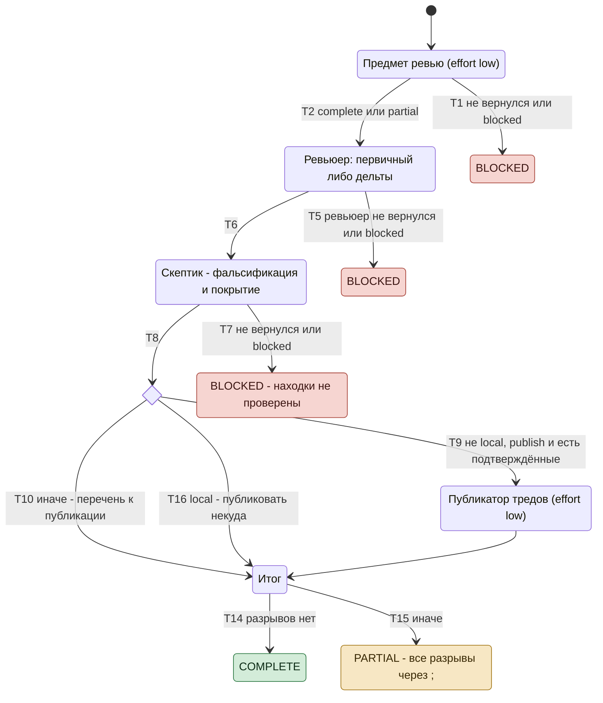

# Трек review: спецификация

Эталон для кода `dex-auto/tracks/review.js`, сценариев `tests/tracks/run.mjs` (префикс `R`) и ревью
трека. Код и сценарии сверяются с этим документом, не наоборот: переход без сценария - дыра покрытия,
ветка кода без перехода - дефект кода либо недописанная спецификация.

Статус документа: **эталон**, сверен с кодом и сценариями R1-R73 (без снятых R11, R17, R27, R36, R37, R42; номер R59 не занят) 11.10.2026, R74-R78 - 12.10.2026, R79-R85 - 13.10.2026, R86-R89 - 14.10.2026, R90 - 15.10.2026, R91-R94 - 20.10.2026, R95 - 22.10.2026; цель трека - BR-AUTO-003

(`../brd.md`); открытых решений нет (раздел 7).

## Диаграмма состояний

Номера T - строки раздела 4. При расхождении с таблицами действуют таблицы.

## 1. Назначение и граница

Трек выносит ревью чужого MR/PR либо своей ветки до MR (`local`): находки проверены скептиком, по покрытию
вынесен вердикт, треды в MR опубликованы только по санкции оператора.

- **Read-only:** код, ветки и коммиты не меняются; рабочий каталог каждого узла - каталог сессии `/auto`, его
  и его HEAD на `head_sha` ставит оркестратор (`local` - `head_sha` и есть HEAD); узел предмета ревью сверяет HEAD с `head_sha` и каталог не
  переключает, ревьюер и скептик ревизию не переключают - другую читают через `git show`; HEAD не на `head_sha`
  либо дерево с незакоммиченными правками - обоим это сказано, и код правки они читают через канал хостинга, `local` - через `git show` на `head_sha`.
- **Трек решает только по фактам:** `status` узла, наличие санкции `publish`, длина перечня. Что находка значит и выдержала ли она проверку - решают узлы.
- **Запись в MR - только узел публикации и только при `publish=true`** (флаг `--post` команды).
  Approve и request changes не ставит никто: `review-verdict` уходит оператору в выход.
- **Итоговый `review-verdict` выносит скептик** по подтверждённым находкам; вердикт ревьюера идёт рядом полем `reviewer_verdict` и итогом не является.
- Вне трека: правка кода, ответы автору в тредах, чужие треды.

## 2. Узлы

| Узел | Агент | Модель / effort | Выход |
|---|---|---|---|
| предмет ревью | `general-purpose` | сессии / low | MR - из канала хостинга; `local` - из git без хостинга: `base_sha` - `merge-base` HEAD с `origin/<base>`, нет её - с локальной `<base>` (`base` не задан - ветка по умолчанию у remote; ветка не найдена, общего предка нет либо своих коммитов нет - `blocked`), взятая ссылка - `base_ref` (R91). Выход: платформа (`local` при своей ветке), `base_sha`, `head_sha`, файлы, `hunks` - изменённые места не-тестовых файлов в объёме ревью (R74), `intent`, `conventions` - пути правил проекта на `head_sha` (CLAUDE.md, документы, которые он называет нормой кода или ревью, гайды, ADR) и `conventions-searched` - где искал (R83); `at_head` - HEAD рабочего каталога совпал с `head_sha` |
| ревьюер | `dex-auto:reviewer`, первичный и дельта | таблица узлов `tracks-shared/nodes.js` | находки P0-P3 с осью, уликой и `premise` - посылкой, которую не доказали код и прогон, с пробой (доказана - пусто), `axes` - исход по каждой оси перечня, `roots` - корень и легитимность каждого решения правки, `none` - на месте правки без решения, `fact-check` - перечень записей со статусом из enum (R89), `conventions-read` - прочитанные пути `conventions`, `review-verdict`, `prior` - запись `{id, anchor, severity, text, status, evidence, premise}` на каждую находку перечня ledger, `threads` - находки тредов MR вне перечня той же формы без `id`, `questions` |
| скептик | `dex-auto:skeptic` | таблица узлов `tracks-shared/nodes.js` | `confirmed`, `dropped` с причиной, `coverage`, `axes-check` - сверка каждой оси ревьюера с исходом `clean` либо `n/a`, `roots-check` - сверка каждого решения ревьюера, `roots-missed` - решения правки, которых нет в `roots`, `review-verdict`, `prior` той же формы со сверенным статусом из словаря стыка `tracks-shared/prior-status.md` |
| публикатор | `general-purpose`, кроме `local` | сессии / low | `published` с `id` находки, url и `note`, `unpublished` с `id` и причиной; `id` - enum из `confirmed` |

Трек `premise` не судит: находка с ним идёт скептику и в ledger, как любая; проба - в строке находки, которую трек подаёт узлу (`проба: ...`).
Ревьюер и скептик - узлы плагина: заменой не страхуются, упал ошибкой платформы - T5 либо T7 и строка `degraded` с причиной (R10, R62).
Ось безопасности - одна из осей ревьюера (P93). Ревьюер и скептик до суждения сверяют перечень доступных скиллов с предметом
правки (стек и работа вне стека) и вызывают `Skill` на каждый задетый, на `Unknown skill` повторяют именем из перечня (R60); предмет ревью и публикатор скиллов не грузят.

## 3. Вход и состояние между прогонами

**Вход** (`args`): `task, mr, local, base, intent, mode, publish, last_review_sha, cwd, open_findings, findings_top`.

- `local` - предмет ревью своя ветка рабочего каталога, `mr` не подаётся; `base` - целевая ветка, против которой
  она сливается (флаг `--base` команды). Ledger тот же: трек `review` / `review-delta`.

- `open_findings` - реестр ledger (`ledger.py findings`): открытые, `partial` и непроверенные находки прошлых прогонов с `id`,
  массивом либо строкой JSON, при каждом прогоне. Прежние находки - эти записи плюс `threads` ревьюера, опознанные и
  пронумерованные по R10 [ledger.md](../ledger.md) (R51). Поле не JSON-массив - строка в `degraded`, прогон идёт,
  записи ledger остаются открытыми, `complete` не отдаётся (R49).
- `findings_top` - вывод `ledger.py top TASK review` при каждом прогоне: новые находки - `F<findings_top+k>`, выход несёт поле обратно для `finish.sh`; не подан - `N<k>` и строка `degraded` (R10 [ledger.md](../ledger.md); R88).

- `last_review_sha` задан - ревизия дельты (трек ledger `review-delta`, реестр общий с `review`): ревьюер дельты, новые
  находки только в дельте. Статус прежней находки у ревьюера - claim: скептик сверяет каждую с кодом `head_sha`, в выход
  `prior` идёт сверенный статус с уликой и `id`; `disputed` - только когда код опровергает находку; «закрыта» не
  подтвердилась - `open` или `partial`, и находка участвует в вердикте. `prior` и `confirmed` скептика входят в реестр
  по R10 (R52, R53).
- `publish` - санкция на инлайн-треды; без неё подтверждённые находки уходят перечнем к публикации.
- `intent` не передан - узел предмета берёт описание MR и тикет (`local` - сообщения коммитов и тикет из них), не нашёл - `n/a` с перечнем, где искал.

**Возобновления нет:** «продолжить» перезапускает трек с теми же `args`, `trail` и `ctx` из ledger не
подаются. Повтор публикации держит публикатор (T9): треды прошлого прогона он находит в MR сам. `finish.sh`
пишет возврат в реестр: `confirmed` - `open`, `claims` - `unverified`, `prior` - свой статус по `id`, `dropped`;
открытые находки - разность реестра, находка без события прогона остаётся открытой.

## 4. Переходы

Выход: `status` / `where`; `blocked` сбоя узла несёт ещё `node_failure: true` (I10). «-» - прогон продолжается.

### Context

| # | Условие | Действие | Выход |
|---|---|---|---|
| T0 | пусто поле args `task`, `cwd` либо `mr` без `local` (R64, R93) | стоп до первого узла | `blocked` / `Context` / «трек вызван без входа: нет <поля>» |
| T0a | `local` и непустой `mr` (R93) | стоп до первого узла | `blocked` / `Context` / «предмет ревью неоднозначен: заданы mr и local» |
| T1 | узел предмета вернул `null` или `blocked` | стоп | `blocked` / `Context` / `missing` узла, «узел вернул blocked без нехватки» либо «узел контекста не вернул выход» |
| T2 | иначе | ревизия, файлы и `conventions` идут в промпты ревьюера и скептика (R84), `hunks` - ревьюеру: каждое место пересекает запись `roots`, решение либо `none` с причиной; рабочий каталог не на `head_sha` либо с незакоммиченными правками (`at_head: false`, R90) - оба читают код правки через канал хостинга, `local` - через `git show` на `head_sha` (R94), `partial` предмета с нехваткой (R61); `partial` предмета - разрыв «предмет ревью неполон»; `at_head: false` при `complete` предмета - разрыв «рабочий каталог не на head_sha» (R65) | - |

### Review

| # | Условие | Действие | Выход |
|---|---|---|---|
| T3 | `last_review_sha` не задан | первичное ревью правки `base_sha..head_sha` | - |
| T4 | `last_review_sha` задан | ревизия дельты: новые находки только в дельте от `last_review_sha`, статус прежних - `prior` и `threads` (`local` - только `prior`: `threads` ревьюера не засчитываются, строка `degraded`; R94) | - |
| T5 | ревьюер `null` / `blocked` | стоп | `blocked` / `Review` / `missing` узла, «узел вернул blocked без нехватки» либо «узел ревью не вернул выход» |
| T6 | иначе | claims = находки ревьюера; скептику каждая идёт с уликой ревьюера, и оси ревьюера `axes` - с исходом. Разрывы: `partial` ревьюера - «ревью не завершено»; ось перечня без записи либо без `outcome` - «ревью: оси не названы» с именами, `unverifiable` - «ревью: ось не проверена» с `checked` (R63); исход `findings` без находок оси в `findings` либо иной исход при них - «ревью: исход оси расходится с findings» (R66, R67); решение `illegitimate` без своей находки в `findings` либо открытой в `prior` или `threads`: её `ref` либо `id` назван полем `finding` решения, иначе она на месте решения (`anchor` либо место из `places`: тот же файл, строки пересекаются, без строки - весь файл; R72, R80, R86) - «ревью: решение нелегитимно без находки» с `anchor` (R70); место из `hunks` без пересекающей записи `roots` - «ревью: место правки без записи roots» с местом (R75); путь из `conventions` вне `conventions-read` - «ревью: правила проекта не прочитаны» с путями, `conventions-read` - enum из поданных путей (R83); пути сверяются без ведущего `./` (R85); `none` в сверку скептика не идёт; верность исхода трек не судит - её судит скептик | - |

### Falsify

| # | Условие | Действие | Выход |
|---|---|---|---|
| T7 | скептик `null` / `blocked` | стоп; claims уходят в выход непроверенными, прежние находки - `prior` со статусом `unverified` | `blocked` / `Falsify` / `missing` узла, «скептик вернул blocked без нехватки» либо «скептик не вернул выход - находки не проверены» |
| T8 | иначе | `confirmed` / `dropped`; запись `confirmed` либо `dropped` судит находку ревьюера с тем же `ref`, запись без `ref` - на месте находки; находка ревьюера без записи в `confirmed`, `dropped` и `prior` - разрыв «находка не сверена скептиком» с `anchor` (R78, R87); ось ревьюера с исходом `clean` либо `n/a` без записи `axes-check` - разрыв «исход оси не сверен скептиком» с именами (R68), `overturned` без находки этой оси в `confirmed` либо открытой в `prior` - разрыв «ось опровергнута без находки» с именем (R69); запись `roots-check` относится к решению с тем же местом (файл и строки совпадают), без такого - к решениям, которые пересекает; относится к нескольким - разрыв «запись сверки покрывает несколько решений» с её `anchor`, решениям она не засчитывается (R73, R79); решение без своей записи (относится только к нему) - разрыв «решение не сверено скептиком» с `anchor`; итог хоть одной своей записи нелегитимен (`legitimate` + `overturned`, `illegitimate` + `upheld`), а своей находки решения (по `finding`, иначе на месте решения: `anchor` либо место из `places`) в `confirmed` либо открытой в `prior` нет - разрыв «решение нелегитимно после сверки без находки» с `anchor`, независимо от порядка записей (R71, R72, R73, R81); запись `roots-missed`, чьё место не пересекает решение ревьюера с вердиктом кроме `none`, - разрыв «решение не перечислено ревьюером» с `anchor` и решением (R76, R77, R82); непокрытая ветка изменённого поведения - находка оси `coverage` в `confirmed`; claims пусты - скептик судит только покрытие; по каждой прежней - сверенный `prior`, прежняя без записи скептика - `unverified` и разрыв «статус прежних находок не сверен скептиком»; итоговый `review-verdict` - правилом словаря стыка `tracks-shared/review-verdict.md` в файле скептика; `APPROVE` при P0/P1 среди них - разрыв; `partial` скептика - разрыв | - |

### Publish

| # | Условие | Действие | Выход |
|---|---|---|---|
| T9 | не `local`, `publish` и `confirmed` непуст | публикатор сначала читает треды MR своего аккаунта: тред по находке на том же anchor уже есть - не публикует, в `published` с его url и `note` «уже был»; иначе тред с severity и критерием закрытия; отказ канала - в `unpublished` с причиной | - |
| T16 | `local` (R91, R92) | публикатор не вызывается, `published` и `unpublished` пусты, подтверждённые находки - в `confirmed` и реестре; `publish` при `local` - строка `degraded` «publish при local не применим: MR нет» | - |
| T10 | не `local`, санкции нет | `unpublished` = все `confirmed` с причиной «санкции publish нет - перечень к публикации» | - |
| T11 | не `local`, `publish`, `confirmed` пуст | публикатор не вызывается | - |
| T12 | публикатор `null` | `unpublished` = все `confirmed` с причиной «узел публикации не вернул выход - находки к публикации»; разрыв | - |
| T13 | публикатор вернул выход, но по части `confirmed` не назвал исхода - сверка по `id` (например `blocked` с пустыми перечнями) | каждая такая находка дописывается в `unpublished` с причиной «публикатор (<status>): исход по находке не назван»; исход с `id` не из `confirmed` не засчитан, строка `degraded`; разрыв | - |

### Final

| # | Условие | Выход |
|---|---|---|
| T14 | разрывов нет | `complete` |
| T15 | иначе | `partial`, `where` и `missing` - все разрывы через `; ` |

Разрывы по порядку: реестр прежних находок не прочитан; предмет ревью неполон; рабочий каталог не на head_sha; ревью не завершено; оси не названы, не проверены либо расходятся с findings; решение нелегитимно без находки; место правки без записи roots; фальсификация не `complete`; исход оси не сверен скептиком либо опровергнут без находки; запись сверки покрывает несколько решений; решение не сверено скептиком либо нелегитимно после сверки без находки; решение не перечислено ревьюером; статус прежних находок не сверен скептиком; часть тредов не опубликована (публикатор `null`, не `complete` либо

`unpublished` непуст); `review-verdict: APPROVE` при открытых P0/P1.

## 5. Инварианты

- **I1.** Ветка трека читает только факт (раздел 1). Решение о значении факта - поле узла.
- **I2.** Ни один узел не меняет код, ветки и коммиты; запись в MR - только публикатор при `publish=true`.
- **I3.** Находка попадает в выход как подтверждённая только через скептика; на остановке T7 claims
  возвращаются отдельным полем и подтверждёнными не называются.
- **I4.** `partial` ревьюера или предмета ревью - трек не отдаёт `complete`.
- **I5.** Ревью MR: каждая подтверждённая находка в выходе либо опубликована (`published` с url), либо названа в
  `unpublished` с причиной - и тогда, когда публикатор о ней промолчал; находка опознаётся `id`: на одном `anchor` и оси
  бывают две находки.
- **I6.** Каждый узел вызывается не больше одного раза за прогон; петель нет.
- **I7.** Каждый не-`complete` выход несёт `where` и непустой `missing`; узел, не назвавший нехватку,
  получает подстановку, а не пустую строку.
- **I8.** Итоговый `review-verdict` и `prior` дельты - выход скептика, не ревьюера: в выход не попадает
  суждение, не прошедшее фальсификацию. Прежняя находка со статусом `open` или `partial` весит в вердикте наравне
  с подтверждённой; прежняя, о которой скептик промолчал, - `unverified`, не закрыта и не открыта молча.
- **I9.** Непросмотренная ось не отдаётся чистой (MOE BR-AUTO-003): ось перечня без исхода, `unverifiable` либо
  исход, расходящийся с `findings` (`findings` без находок оси, иной исход при них), исход `clean` либо `n/a`, не
  сверенный скептиком, решение, не сверенное им, место правки без записи `roots` и решение, названное скептиком в
  `roots-missed`, - трек не отдаёт `complete`.
- **I10.** `blocked` из сбоя узла (контекст, ревьюер либо скептик не вернули выход или вернули `blocked`) несёт `node_failure: true`. `finish.sh` нехватку сбоя узла в `Нехватку трека` не пишет ([ledger.md](../ledger.md) R11) (R95).

## 6. Что делает оператор на остановке

| Остановка | Что решает оператор | Что делает «продолжить» |
|---|---|---|
| T1 - предмет недоступен | доступ к MR, ревизии, каналу хостинга; `local` - целевая ветка `--base`, коммиты на ветке | трек с нуля |
| T5 - ревьюер не отработал | причина по `missing` и `degraded`; `dex-auto` без узла - обновляет плагин | трек с нуля |
| T7 - находки не проверены | ничего либо даёт недостающее скептику | трек с нуля; claims и прежние прошлого прогона приходят из ledger `unverified` и идут скептику прежними |
| T15 - треды не опубликованы | публикует сам по перечню либо перезапускает с `--post` | трек с нуля; опубликованные треды публикатор находит в MR и не дублирует |
| T15 - ревью не завершено | по `missing` даёт недостающее, обновляет `dex-auto` без узла ревью либо принимает риск строкой в `### Решения` | трек с нуля |

## 7. Открытые решения

Нет.
